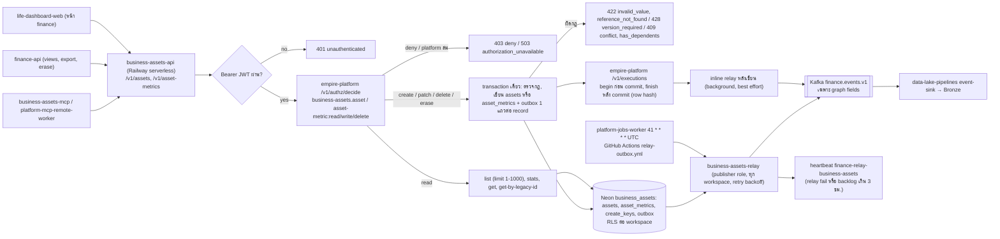

# 01 — Business process (As-Is / To-Be)

finance-business-assets-api (cell `business-assets`) เก็บสินทรัพย์ของธุรกิจที่ไม่ใช่เงินในบัญชี (content, code, audience, data, brand, system, network, ip) พร้อมมูลค่าโดยประมาณ และ metric รายวันต่อสินทรัพย์ ให้ owner ใช้ผ่าน `life-dashboard-web`, `finance-api` และ MCP

Last reviewed: 2026-11-27 · commit `e662501`

## As-Is (จากโค้ดวันนี้)

Sources: `cell.yaml`, `pyproject.toml` (platform-cellkit v1.1.1: `cellkit/app.py`, `cellkit/relay.py`, `cellkit/gateway.py`), `migrations/0001_business_assets.sql`–`0004_cross_references.sql`, `.github/workflows/relay-outbox.yml`, `.railway/railway.ts`, `README.md`, `PRODUCT.md`

ข้อเท็จจริงสำคัญจากโค้ด:

- โค้ดของ cell มีแค่ `cell.yaml`; route, auth, outbox และ relay มาจาก platform-cellkit v1.1.1 (`src/solo_business_assets/` ว่าง)
- asset: `name` (ไม่เกิน 200 ตัว) และ `asset_type` บังคับ; `status` ค่าเริ่มต้น planning; `monthly_value`, `total_value` เป็น `money` ติดลบไม่ได้; `currency` ISO 4217 ค่าเริ่มต้น THB
- asset-metric: `asset_id` ต้องเป็น asset ใน workspace เดียวกัน (foreign key ในฐานข้อมูลเดียวกัน, 422 `reference_not_found`); หนึ่งแถวต่อ asset ต่อวัน (409); `views`, `subscribers`, `revenue` ค่าเริ่มต้น 0 ติดลบไม่ได้; list เรียงตาม `metric_date`
- asset ที่ยังมี metric ลบไม่ได้ (409 `has_dependents`); erase ข้าม asset ที่ยังมี metric ชี้อยู่และนับใน `remaining` (SPEC-008)
- PATCH ที่ส่งฟิลด์เงิน (`monthly_value`, `total_value`, `revenue`) ต้องมี `expected_version` (428, SPEC-009)
- event: `business-assets.asset.*` มี `asset_type`, `status`, `currency`, `launched_at`; `business-assets.asset-metric.*` มี `asset_id`, `metric_date` (ไม่มียอดเงิน ชื่อ หรือ notes)
- cell นี้ไม่มี `references` / `referenced_by` ข้าม cell: ไม่ได้อ่าน Kafka กลับมา
- ไม่มีโค้ดใน repo นี้ที่เขียน `asset-metric` ตามรอบ [ต้องยืนยัน: job หรือคนที่เขียน]
- การตรวจ `X-Gateway-Assertion` (off/report/enforce) และ inline relay ขึ้นกับตัวแปรบน Railway [ต้องยืนยัน: ค่าใน production]

## To-Be (จาก `PRODUCT.md` §Measures และ `specs/004-identity-issuer-trust/spec.md`)

- `specs/004-identity-issuer-trust/spec.md`: cell เชื่อ token ของ platform-identity เคียงข้าง empire-platform; โค้ดอยู่ใน kit แล้ว แต่ "production activation needs a separate owner go"
- `PRODUCT.md` §Measures (Proposed, ยังไม่มีอะไรเก็บ): asset active ที่มี metric ใน 30 วันล่าสุด, ผลรวม `monthly_value` ของ asset active ต่อสกุลเงิน (dashboard แสดงอยู่แล้ว), 5xx และ p95 latency ของ `/v1/assets`
- `PRODUCT.md` §Capabilities: out of scope = การดึง metric จาก platform และบัญชีรายได้ (อยู่ที่ CRM ledger)

## Gap

| ID | As-Is → To-Be | Status | Owner | Evidence |
|---|---|---|---|---|
| G1 | รับ token ของ platform-identity ได้ในโค้ด แต่ยังไม่ยืนยันว่าเปิดใน production → owner ตัดสินเปิดใช้ (ตั้ง `BUSINESS_ASSETS_JWT_IDENTITY_*`) | decide | owner | `specs/004-identity-issuer-trust/spec.md` (Status) |
| G2 | ไม่มีอะไรเก็บ Measures ที่เสนอไว้ → เก็บและรายงานตาม `PRODUCT.md` | decide | owner | `PRODUCT.md` §Measures ("Proposed (nothing collects them yet)") |
| G3 | ไม่มีอะไรใน repo เขียน metric รายวัน → measure "asset active ที่มี metric ใน 30 วัน" ต้องมีแหล่งเขียน metric | decide | owner | `PRODUCT.md` §Product Purpose [ต้องยืนยัน]; §Capabilities (out of scope: collecting the metrics) |

## Open questions

- ใครหรือ job ใดเขียน `asset-metric` (PRODUCT.md ระบุ `[ต้องยืนยัน]`)
- โหมด gateway assertion และ signed events (`BUSINESS_ASSETS_EVENT_SIGNATURES`) ใน production เป็นค่าใด
